<div align="center">

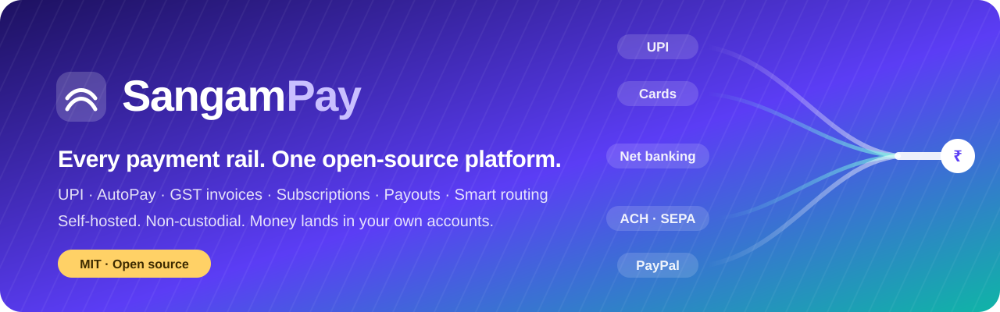

<br>

**Open-source, self-hosted payment platform for India and the world.**<br>
UPI · AutoPay · net banking · cards · ACH/SEPA · PayPal · GST invoices · subscriptions · payouts, behind one API.<br>
Money settles straight into **your own** accounts.

<br>

[](https://github.com/Rohesen/sangampay/actions/workflows/ci.yml)
[](LICENSE)


[](CONTRIBUTING.md)

[**Quick start**](#-quick-start) · [**Features**](#-features) · [**Screenshots**](#-screenshots) · [**API**](#-api-at-a-glance) · [**Integrations**](#-integrations) · [**Security**](#-security)

<br>

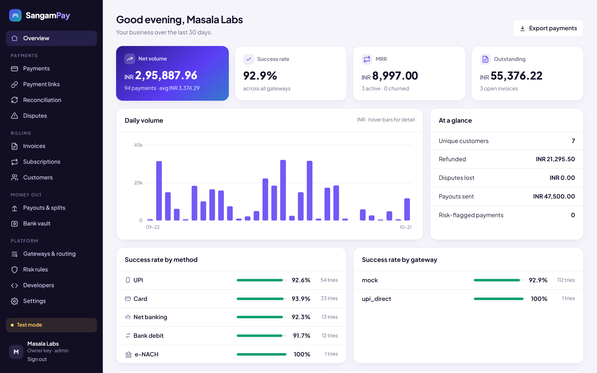

</div>

<br>

> **Sangam** (संगम) means *confluence*, the place where rivers meet. SangamPay is where every payment rail meets
> one clean API, with no lock-in and no middleman holding your money.

## ✨ Why SangamPay

Gateways like Razorpay and Stripe are excellent, but each one is a silo with its own dashboard and its own outages,
and it holds your money until settlement. SangamPay sits **on top of** them, adds what they don't have, and runs on
your own server.

| | A single gateway | **SangamPay** |
|---|---|---|
| Gateway goes down | Checkout breaks | **Automatic failover** to the next gateway, circuit breaker per gateway |
| Which gateway to use | Whatever you integrated | **Smart routing**: by priority, **live success rate**, or **lowest cost** |
| UPI fees | MDR on every payment | **₹0 direct UPI** to your own UPI ID, with **automatic bank-statement reconciliation** |
| Your money | Held by the gateway, settled T+1/T+2 | **Non-custodial**: lands directly in your accounts |
| Reporting | One dashboard per gateway | **One ledger and analytics** across every gateway |
| Lock-in | Contracts, APIs, data | Switch gateways with a config change; your data stays in your Postgres |
| Source | Closed | **MIT open source**, auditable, self-hosted |

## 🚀 Features

<table>
<tr>
<td width="33%" valign="top">

**💳 Accept payments**
- UPI (intent, QR) and zero-fee direct UPI
- Net banking (pay from bank account)
- Cards, Apple Pay and Google Pay
- ACH, SEPA, Bacs, BECS debits
- PayPal in 200+ countries
- Hosted checkout, mobile-first, dark mode
- Payment links with QR codes

</td>
<td width="33%" valign="top">

**🔁 Billing**
- Subscriptions with **UPI AutoPay**, **e-NACH**, card mandates and ACH/SEPA
- Or a payable invoice each cycle
- Trials, quantities, cancel at period end
- Smart dunning retries
- **GST tax invoices**: CGST/SGST/IGST, HSN/SAC, place of supply
- Hosted, printable invoices with a Pay button
- MRR and churn

</td>
<td width="33%" valign="top">

**🏦 Money out and operations**
- Payouts by IMPS, NEFT, RTGS, UPI (RazorpayX)
- Marketplace split payments (Route, Connect)
- Full and partial refunds
- Disputes and chargebacks with evidence submission
- Bank-statement auto-reconciliation
- Double-entry ledger, CSV exports

</td>
</tr>
<tr>
<td valign="top">

**🧠 Smart routing**
- Priority, success-rate or cost strategies
- Bayesian live success scores per gateway and method
- Automatic failover, circuit breaker
- Live gateway health dashboard

</td>
<td valign="top">

**🛡️ Risk and security**
- Fraud rules: blocklists, country allow-list, amount caps, velocity limits
- 0–100 risk score with reasons on every payment
- AES-256-GCM envelope-encrypted vault
- Signed webhooks, SSRF guard, rate limiting
- Idempotency keys everywhere

</td>
<td valign="top">

**👩‍💻 Developers and teams**
- Clean REST API with OpenAPI docs at `/docs`
- Python and Node SDKs (zero dependencies)
- WooCommerce plugin, Shopify bridge
- Team API keys with roles
- Audit log of every change
- Test mode with sandbox and time travel

</td>
</tr>
</table>

## 🖼️ Screenshots

<table>
<tr>
<td width="50%">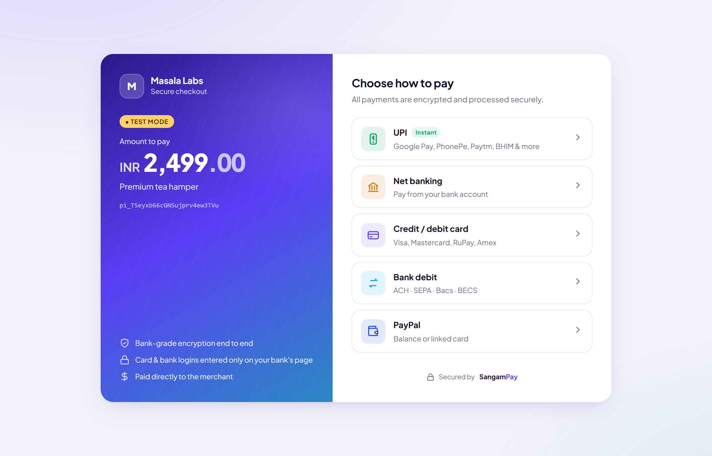<br><sub><b>Hosted checkout</b>: every method, one page</sub></td>
<td width="50%">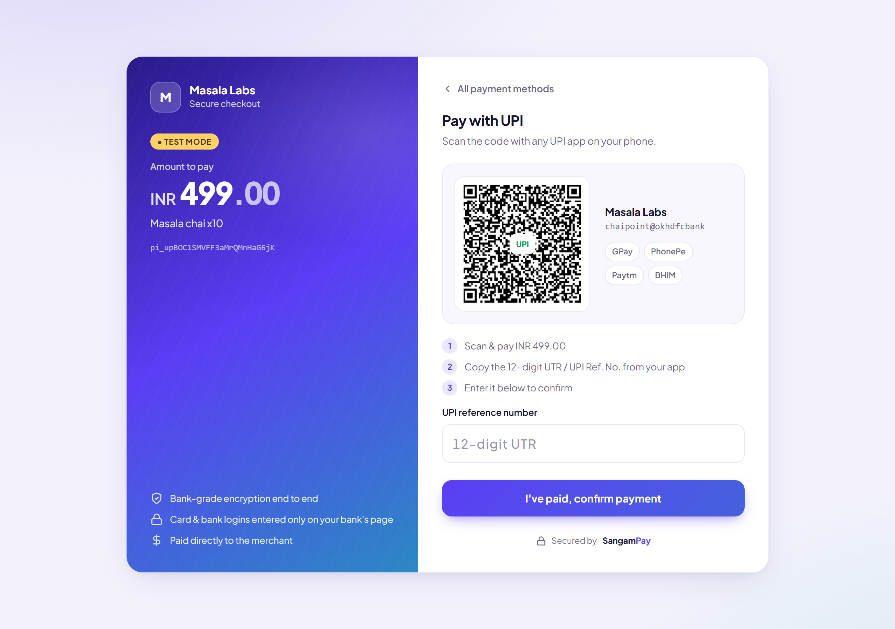<br><sub><b>Zero-fee UPI</b>: QR, app deep link, UTR confirmation</sub></td>
</tr>
<tr>
<td>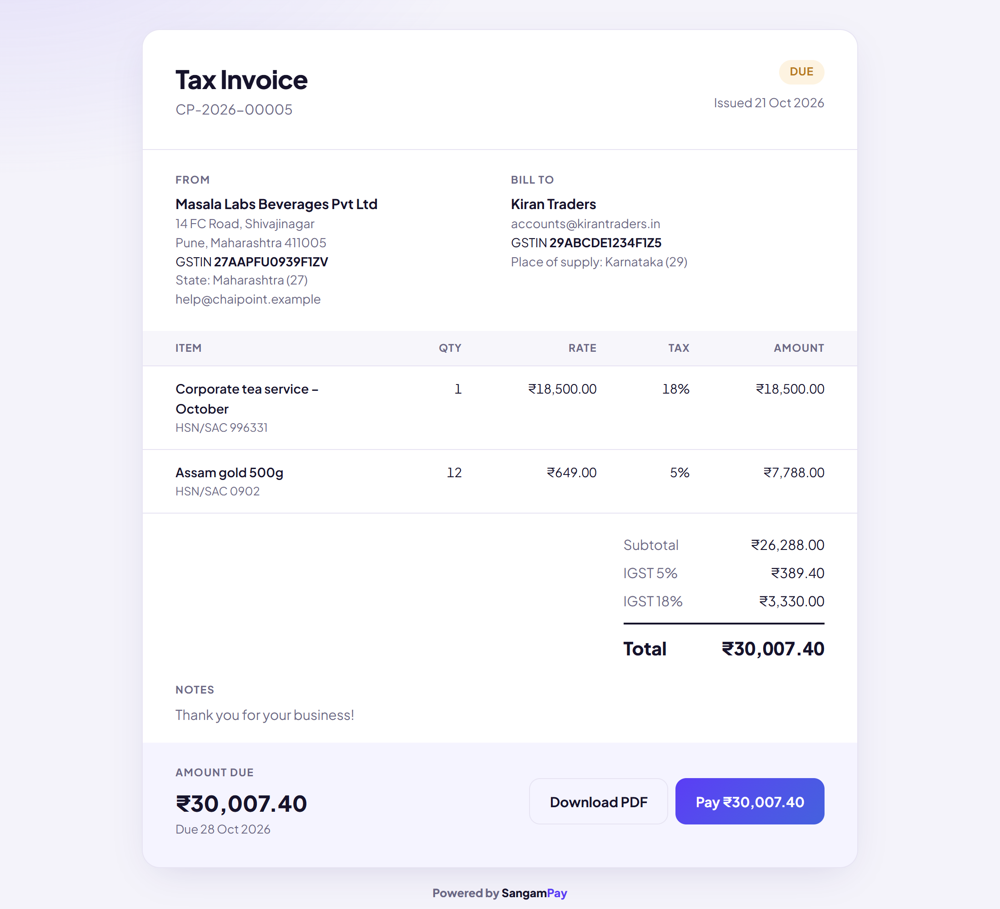<br><sub><b>GST tax invoice</b> with IGST/CGST/SGST and a Pay button</sub></td>
<td>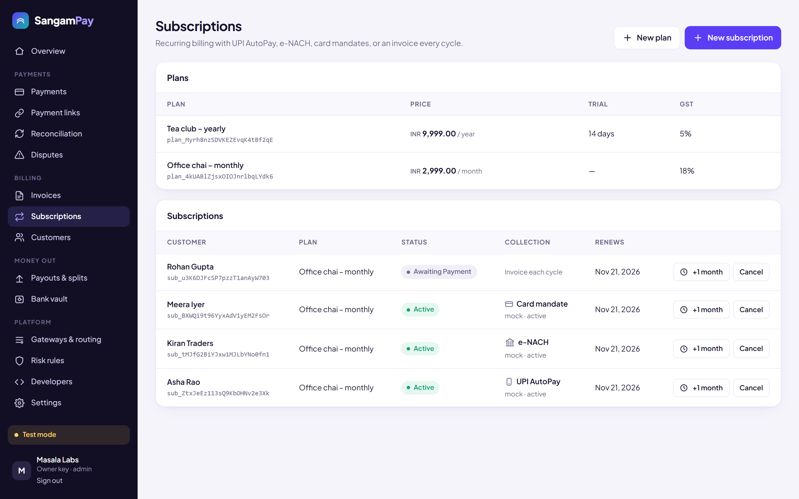<br><sub><b>Subscriptions</b> with UPI AutoPay, e-NACH and card mandates</sub></td>
</tr>
<tr>
<td>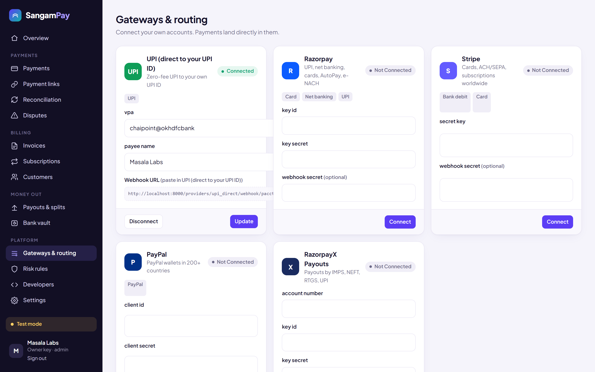<br><sub><b>Gateways and smart routing</b> with live health</sub></td>
<td>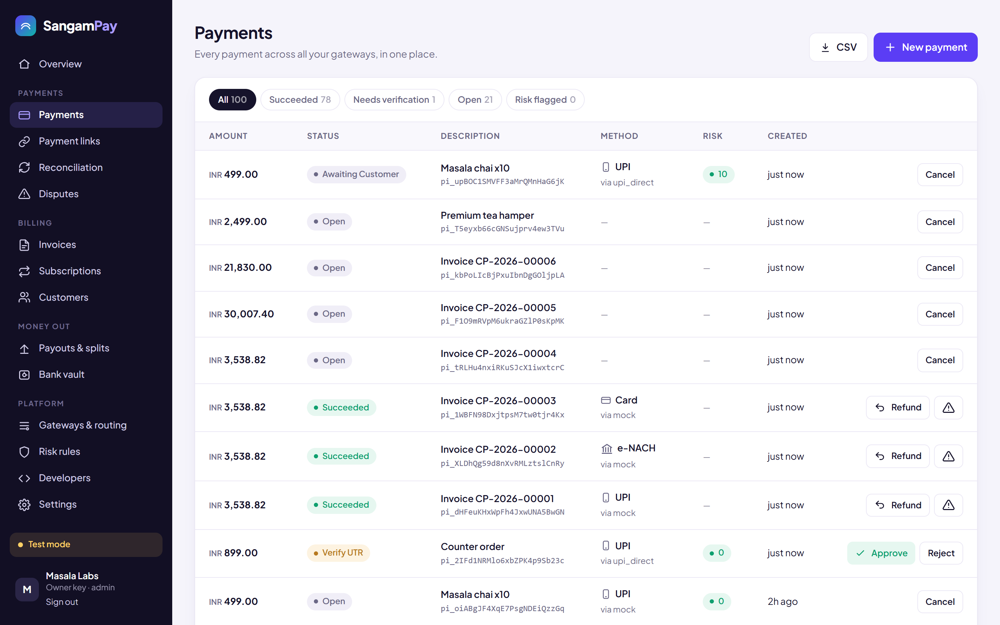<br><sub><b>Payments</b> across every gateway, with risk scores</sub></td>
</tr>
<tr>
<td>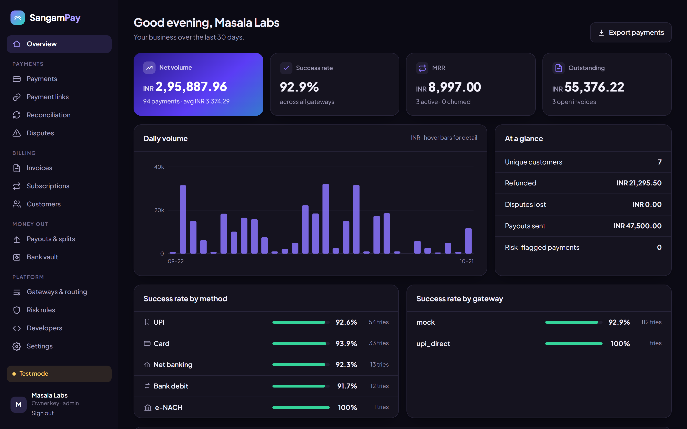<br><sub><b>Dark mode</b>, automatically</sub></td>
<td align="center">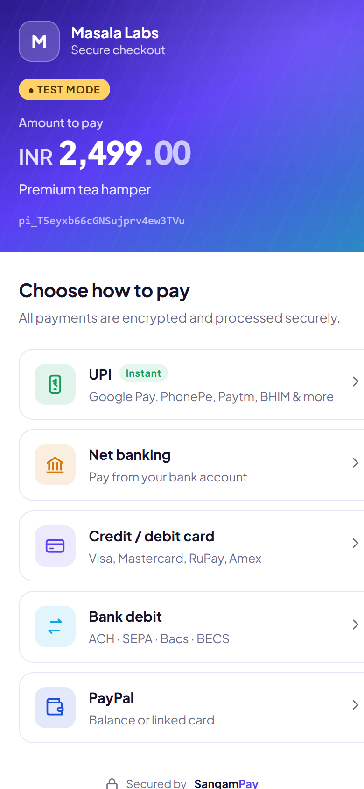&nbsp;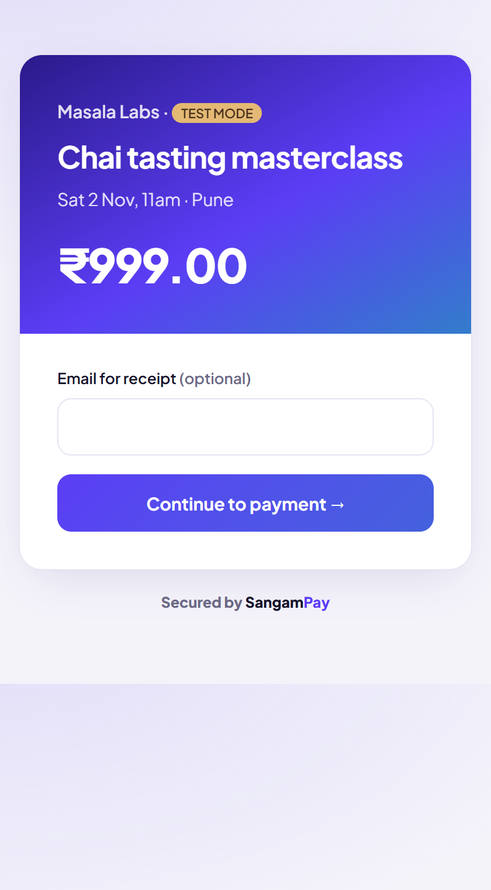<br><sub><b>Mobile checkout</b> and <b>payment links</b></sub></td>
</tr>
</table>

## ⚡ Quick start

**Run it locally (Python 3.10+):**

```bash
git clone https://github.com/Rohesen/sangampay.git && cd sangampay
pip install -r requirements.txt
uvicorn sangam.main:app --reload
```

**Load realistic demo data** (in a second terminal) and open <http://localhost:8000/dashboard>:

```bash
python -m sangam.demo
```

It prints a test secret key. Paste it into the dashboard and explore. In **test mode** every payment method works
through a built-in sandbox, including mandates, payouts and disputes.

**Production with Docker + Postgres:**

```bash
cp .env.example .env   # set SANGAM_MASTER_KEY and SANGAM_BASE_URL
docker compose up -d --build
```

## 🧩 How it works

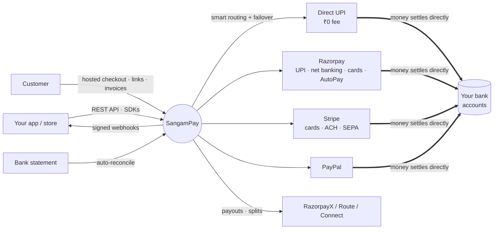

## 🔌 Integrate in 3 steps

**1. Create a payment on your server**

```python
from sangampay import SangamPay        # pip install ./sdks/python

sp = SangamPay("sk_test_...", base_url="http://localhost:8000")
pi = sp.payment_intents.create(amount=49900, currency="INR",       # amounts in paise: ₹499.00
                               description="Order #1001", idempotency_key="order-1001",
                               customer={"email": "asha@example.in"},
                               return_url="https://yourshop.com/orders/1001")
```

**2. Send the customer to checkout:** redirect to `pi["checkout_url"]`, or use the browser SDK:

```html
<script src="https://pay.yourdomain.com/sdk/sangam.js"></script>
<script>Sangam.checkout({ checkoutUrl: "{{ checkout_url }}" })</script>
```

**3. Fulfil from a signed webhook**

```python
from sangampay import verify_webhook

event = verify_webhook(request.body, request.headers["Sangam-Signature"], "whsec_...")
if event["type"] == "payment_intent.succeeded":
    mark_order_paid(event["data"]["id"])
```

<details>
<summary><b>Same in Node.js</b></summary>

```js
const { SangamPay, verifyWebhook } = require("sangampay");   // npm install ./sdks/node
const sp = new SangamPay(process.env.SANGAM_KEY, { baseUrl: "http://localhost:8000" });
const pi = await sp.paymentIntents.create({ amount: 49900, currency: "INR" }, { idempotencyKey: "order-1001" });

app.post("/webhooks/sangam", express.raw({ type: "application/json" }), (req, res) => {
  const event = verifyWebhook(req.body, req.get("Sangam-Signature"), process.env.SANGAM_WEBHOOK_SECRET);
  if (event.type === "payment_intent.succeeded") markOrderPaid(event.data.id);
  res.sendStatus(200);
});
```
</details>

<details>
<summary><b>Subscriptions with UPI AutoPay</b></summary>

```python
cus  = sp.customers.create(name="Kiran Traders", gstin="29ABCDE1234F1Z5")
plan = sp.plans.create(name="Pro", amount=49900, currency="INR", interval="month", tax_rate=18, trial_days=14)
sub  = sp.subscriptions.create(customer=cus["id"], plan=plan["id"], collection="mandate", mandate_method="upi")
print(sub["mandate"]["authorization_url"])   # customer approves AutoPay once; renewals are automatic
```

In test mode, `POST /v1/test_helpers/subscriptions/{id}/advance {"days": 31}` fast-forwards time so you can watch
renewals, failed payments and dunning.
</details>

<details>
<summary><b>GST invoice</b></summary>

```python
inv = sp.invoices.create(customer=cus["id"], currency="INR", line_items=[
    {"description": "Consulting – October", "quantity": 1, "unit_amount": 1850000, "tax_rate": 18, "hsn_sac": "998311"}])
print(inv["hosted_invoice_url"])   # printable tax invoice with a Pay button; IGST or CGST+SGST chosen automatically
```
</details>

<details>
<summary><b>Auto-reconcile zero-fee UPI against your bank statement</b></summary>

```python
report = sp.reconcile(open("hdfc-statement.csv").read())
# matches credits by UTR + amount, or by the payment ID sent as the UPI reference,
# and confirms those payments automatically
```
</details>

## 💸 Payment methods

| Customer | Method | Routed through | Money goes to |
|---|---|---|---|
| 🇮🇳 India | `upi` | `upi_direct` (₹0) or `razorpay` | Your bank account |
| 🇮🇳 India | `netbanking` | `razorpay` | Your Razorpay account → bank |
| 🇮🇳 India | UPI AutoPay, e-NACH, card mandates | `razorpay` | Your Razorpay account → bank |
| 🌍 Global | `card` (+ Apple/Google Pay) | `stripe`, `razorpay` | Your gateway account |
| 🇺🇸🇪🇺🇬🇧🇦🇺 | `bank_debit` (ACH, SEPA, Bacs, BECS) | `stripe` | Your Stripe account |
| 🌍 200+ countries | `paypal` | `paypal` | Your PayPal account |
| 🧪 Test mode | everything | `mock` sandbox | Nowhere (simulation) |

Adding a gateway (Cashfree, PayU, PhonePe PG, Adyen, Mollie, Pix, M-Pesa…) takes one adapter class. See
[`sangam/providers/base.py`](sangam/providers/base.py).

## 📚 API at a glance

Interactive OpenAPI docs are served at `/docs`. All amounts are integers in the currency's smallest unit.

| Area | Endpoints |
|---|---|
| Payments | `POST/GET /v1/payment_intents` · `…/{id}/confirm` · `…/cancel` · `…/verify` · `…/attempts` |
| Refunds | `POST/GET /v1/refunds` · `…/{id}/mark_completed` |
| Payment links | `POST/GET /v1/payment_links` · `PATCH …/{id}` |
| Customers | `POST/GET/PATCH /v1/customers` |
| Subscriptions | `POST/GET /v1/plans` · `POST/GET /v1/subscriptions` · `…/{id}/cancel` |
| Invoices | `POST/GET /v1/invoices` · `…/finalize` · `…/void` · `…/mark_paid` |
| Reconciliation | `POST/GET /v1/reconciliation` (CSV or JSON rows) |
| Disputes | `GET /v1/disputes` · `…/{id}/evidence` · `…/{id}/accept` |
| Payouts and splits | `POST/GET /v1/payouts` · `GET /v1/transfers` |
| Vault | `POST/GET/DELETE /v1/bank_accounts` |
| Routing and risk | `PUT /v1/merchant/routing` · `PUT /v1/merchant/settings` · `PUT /v1/merchant/risk_rules` · `GET /v1/routing/health` |
| Insights | `GET /v1/analytics` · `GET /v1/balance` · `GET /v1/exports/{payments,refunds,invoices}.csv` |
| Team | `GET/POST/DELETE /v1/api_keys` · `GET /v1/audit_logs` |
| Webhooks | `POST/GET/DELETE /v1/webhook_endpoints` · `GET /v1/events` · `…/{id}/resend` |

**Webhook events:** `payment_intent.*` (created, succeeded, processing, payment_failed, requires_verification, canceled,
blocked, risk_flagged, duplicate_payment) · `refund.*` · `invoice.*` (finalized, paid, voided) · `subscription.*`
(created, activated, mandate_authorized, payment_failed, past_due, unpaid, canceled) · `dispute.*` · `payout.*` ·
`transfer.*` · `reconciliation.completed`

## 🔗 Integrations

| | |
|---|---|
| 🐍 **Python SDK** | [`sdks/python`](sdks/python): zero dependencies, retries, webhook verification |
| 🟩 **Node.js SDK** | [`sdks/node`](sdks/node): zero dependencies, TypeScript types |
| 🛒 **WooCommerce** | [`integrations/woocommerce`](integrations/woocommerce): payment gateway plugin with refunds and HPOS support |
| 🛍️ **Shopify** | [`integrations/shopify`](integrations/shopify): order-to-payment-link bridge (Shopify restricts payment apps to approved partners) |
| 🌐 **Any website** | `<script src="/sdk/sangam.js">` or a plain redirect to `checkout_url` |

## 🔒 Security

- **Bank details are not collected where avoidable.** Net banking, cards and debits are entered on the bank's or
  gateway's own page, which keeps you in the lightest PCI DSS scope (SAQ A).
- **Encrypted vault.** When bank details must be stored (payout and refund accounts) they use AES-256-GCM envelope
  encryption with a per-record key, bound to the owner. The API is write-only, returns masked values, and supports
  crypto-shredding and master-key rotation.
- **Payment status is never taken from the browser.** It comes only from server-to-server gateway calls or
  signature-verified gateway webhooks.
- **Signed webhooks** (HMAC-SHA256 with a timestamp), SSRF protection on webhook URLs, rate limiting, idempotency
  keys, API keys stored as hashes, role-based keys and a full audit log.

Found a vulnerability? See [SECURITY.md](SECURITY.md).

## ⚖️ Compliance

SangamPay is **non-custodial orchestration software**: it never receives or holds customer funds. That is what makes
it legal for anyone to self-host. If you modify it to pool money and pay merchants later, you become a payment
aggregator, which in India requires RBI authorisation (and equivalent licences elsewhere). Also follow PCI DSS (never
handle raw card numbers), RBI's card-storage and e-mandate rules, and India's DPDP Act / GDPR for personal data.

## 🗺️ Roadmap

- [ ] More gateways: Cashfree, PayU, PhonePe PG, Juspay, Adyen
- [ ] Account Aggregator / bank APIs for real-time direct-UPI confirmation
- [ ] Multi-user dashboard login with SSO
- [ ] Customer portal (manage subscriptions, download invoices)
- [ ] E-invoicing (IRN) and GSTR-1 export
- [ ] Redis-backed rate limits, Alembic migrations
- [ ] React and Flutter checkout components

## 🛠️ Development

```bash
pip install -r requirements.txt -r requirements-dev.txt
pytest -q                                   # 33 end-to-end tests
python -m sangam.demo                       # demo data
python scripts/screenshots.py --key sk_test_...   # regenerate README screenshots
```

Project layout: `sangam/` (server) · `sangam/providers/` (one adapter per gateway) · `sangam/static/` (checkout and
dashboard, no build step) · `sdks/` · `integrations/` · `tests/`.

## 🤝 Contributing

Contributions are very welcome, especially new gateway adapters, bank-statement formats and translations. Read
[CONTRIBUTING.md](CONTRIBUTING.md) to get started.

## 📄 License

[MIT](LICENSE). Free for personal and commercial use.

<div align="center"><sub>Built with ❤️ in India for businesses everywhere.</sub></div>
